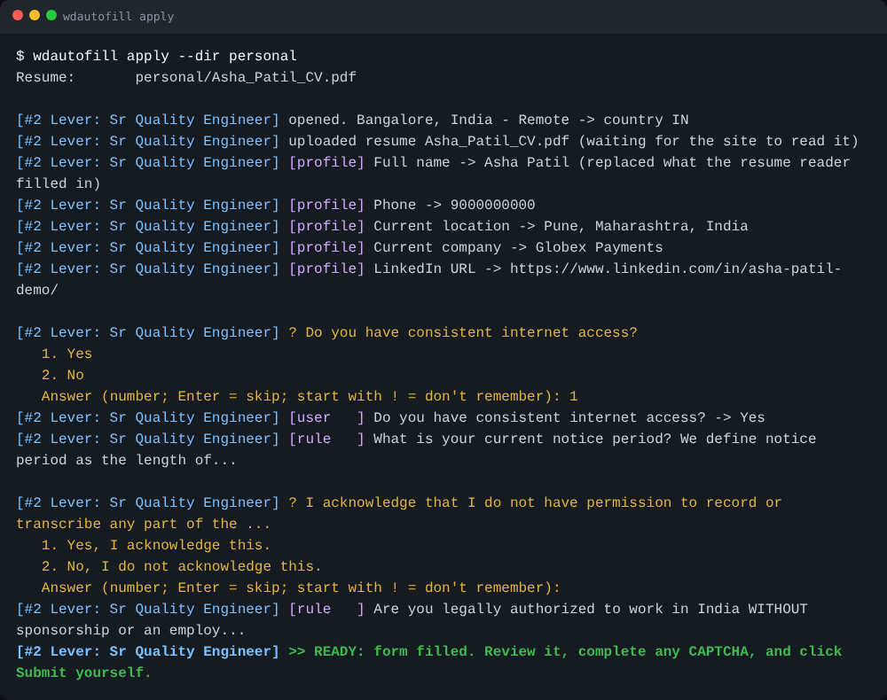
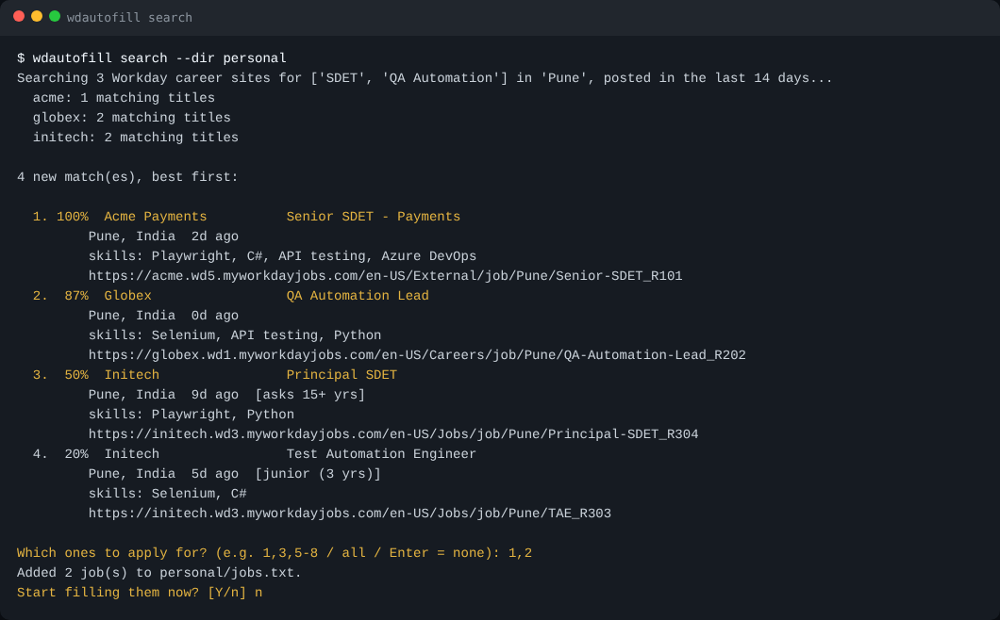
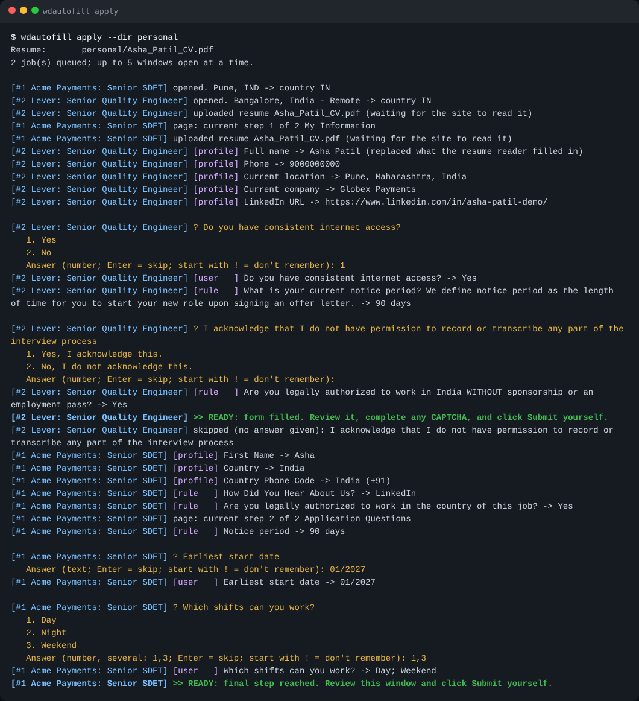
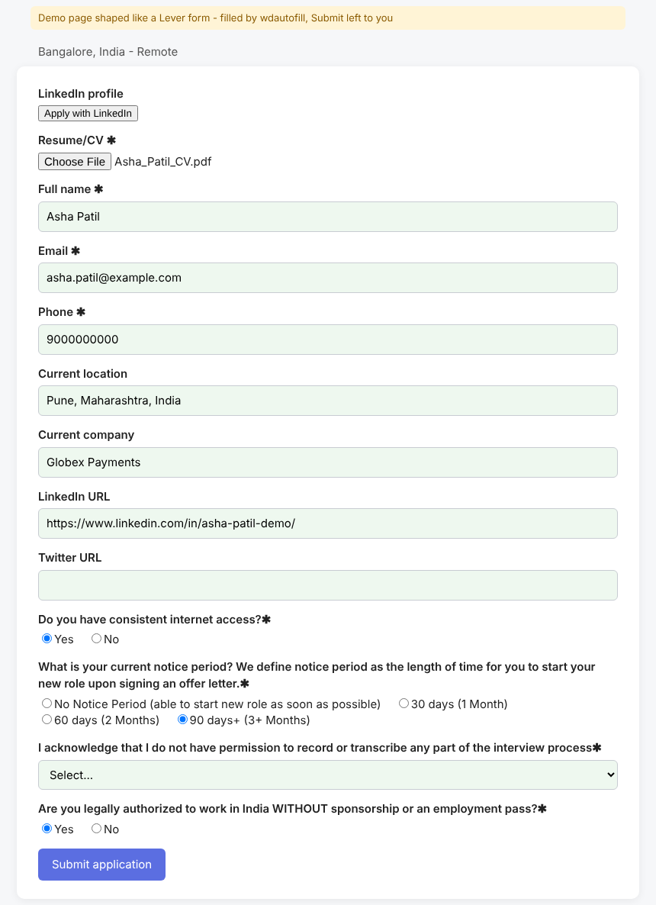
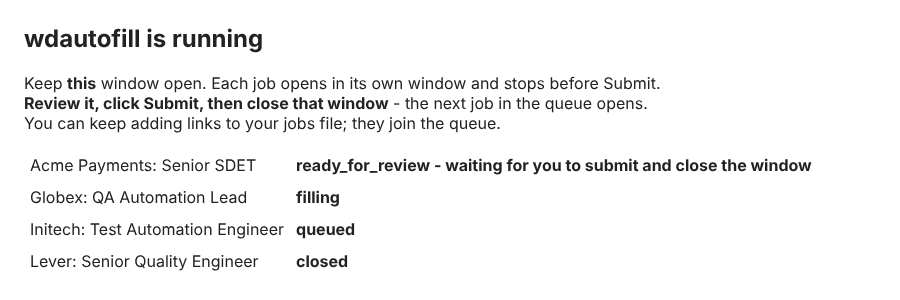

# workday-autofill

**Stop retyping your life story into every job portal.**

Free, open-source autofill for **Workday, Lever and Greenhouse** job applications.
It finds matching jobs, opens one window per application, fills every page from your
profile, uploads your resume and a cover letter written for that company, and asks
you each new question **only once - ever**. Then it stops so **you** review and click
Submit.

[](LICENSE)
[](https://www.python.org/)
[](https://github.com/HarshadLambate/workday-autofill/actions/workflows/tests.yml)
[](https://buymeacoffee.com/lambate05p)



## Why

Every company on Workday makes you create a new account and type the same name,
address, work history, education, "How did you hear about us?" and visa questions -
again. Ten applications cost an evening. This tool turns that evening into a coffee
break:

- **Answer once, reuse forever.** Every answer you give is saved; the next portal that
  asks the same thing gets it automatically - in every company, in every window.
- **Many applications at once.** Paste 10 links (or 100): it fills them in parallel
  windows and queues the rest.
- **Finds jobs for you.** `wdautofill search` checks companies' own career sites for
  your keywords and city, scores each job against your skills, and lets you pick.
- **You stay in control.** It never clicks Submit, never solves CAPTCHAs, never fills
  hidden bot traps, and never lets an AI guess legal or personal answers (visa,
  criminal record, gender...). Those come only from answers *you* wrote.
- **Free, private, runs on your computer.** No subscription, no account, no server.
  AI is optional - and can be a free one, even fully offline (Ollama).
- **A cover letter per company.** Write one template; every job gets its own copy with
  the company name, job title and location filled in.

I built this during my own job search in 2026, after typing the same details into
one Workday portal too many.

## What it looks like

**Find and shortlist jobs** - scored against your skills, flagged when the experience asked doesn't fit:



**Two applications at once** - Workday and Lever side by side; you're only asked what's new:



**A filled form, waiting for your review** - Submit (and any CAPTCHA) is yours:



**One status window** for the whole queue - close a job's window after submitting and the next one opens:



*Screenshots are generated from demo pages and a demo applicant by
[`docs/make_screenshots.py`](docs/make_screenshots.py) - the real tool, fake data.*

## Quick start

You need Python 3.10+ ([python.org](https://www.python.org/downloads/)).

```bash
git clone https://github.com/HarshadLambate/workday-autofill
cd workday-autofill
python -m venv .venv
# Windows: .venv\Scripts\activate      macOS/Linux: source .venv/bin/activate
pip install -e ".[openai]"     # the extra is only needed for AI; plain `pip install -e .` works too
playwright install chromium

wdautofill init --dir personal      # creates your private files (git-ignored)
```

Then, in the `personal` folder:

1. Edit `profile.yaml`: your name, contact details, links, work history, education,
   and `rules:` for the questions every company asks.
2. Put your resume there (and optionally `cover_letter_template.docx`).
3. Find jobs, or paste job links into `jobs.txt` (one per line, any number):

```bash
wdautofill search --dir personal    # shortlist matching jobs into jobs.txt
wdautofill apply  --dir personal    # fill every job in jobs.txt
```

The first time on each company's Workday site you create an account (the tool types
your email and password; ticking the terms box and the email code are yours).
After that it signs in by itself.

## How answers are decided

For every field, in this order:

1. **Profile** - name, email, phone, address, links, current company, work history,
   education. Your profile always wins, even over what a site's resume reader typed
   (`ASHA` -> `Asha`).
2. **Your rules** - your fixed answer for every question whose wording matches, at every
   company: *How did you hear about us -> LinkedIn*, *Have you ever worked for
   &lt;company&gt; -> No*, *Notice period -> 90 days*, *Sponsorship -> No in India, Yes
   elsewhere*. A list of answers = the first one that exists on that form.
3. **Answer bank** (`answers.yaml`) - every answer you typed before.
4. **AI (optional)** - fills *ordinary* questions when confident, and must pick a real
   option. It reads your `instructions.md` (plain sentences about you).
5. **You** - asked once in the terminal (that window comes to the front), then remembered.

**The safety rule:** legal and identity questions - work authorization, sponsorship,
criminal history, disability, gender, ethnicity, religion, age, salary, consents - are
**never filled by the AI**. They come from your rules or saved answers; otherwise the
AI may only *suggest* an answer that you accept with Enter. These are statements you
sign. Answers that depend on the job's country (visa, sponsorship) are kept per country.

## Which sites work

| Site | Support |
|---|---|
| **Workday** (`*.myworkdayjobs.com`) | Full flow: sign-in / create account, Autofill with Resume, My Information, My Experience (adds/removes work-history and education blocks), questions, voluntary disclosures. Stops on Review. |
| **Lever** (`jobs.lever.co`) | One-page form: resume, contact details, location suggestions, current company, links, custom questions. |
| **Greenhouse** and other ordinary forms | Best effort: questions found by their labels; "Next"/"Continue" steps followed. |
| Oracle Recruiting, sites needing an emailed code first | Not yet - the window opens and you apply there. |

Workday sites differ between companies. When a page can't be finished, the window waits
for you and the page's structure (field names only, never your answers) is saved in
`personal/debug/` - attach it to an [issue](../../issues/new/choose) and it can be fixed.

## Finding jobs: `wdautofill search`

`search` asks each company's own Workday career site (listed in `companies.txt`) for
your keywords and location, keeps recent jobs, and scores them against your `skills`
(and flags jobs asking for far more or far fewer years than you have). Pick with
`1,3,5-8` or `all`; picks go to `jobs.txt`. Jobs already queued or applied to are not
shown again.

LinkedIn is not searched: its terms forbid automated scraping, and accounts that do it
get restricted. If a LinkedIn job's Apply button leads to Workday, Lever or Greenhouse,
paste that link into `jobs.txt`.

## Filling applications: `wdautofill apply`

- Links come from `jobs.txt`, the command line, or pasted into the terminal. Add more to
  `jobs.txt` while it runs - they join the queue. Jobs filled before are skipped
  (`--again` redoes them).
- One window per job, at most `--parallel 5` open. **Review, click Submit, close the
  window** - the next job opens.
- Resume goes to every Resume/CV box; your cover letter template becomes
  `cover_letters/<You>_Cover_Letter_<Company>.docx` and goes to Cover Letter boxes.
- New questions come to the terminal one at a time, tagged with the job. If several
  windows need the same new question, you're asked once.

Flags: `--parallel N`, `--country IN`, `--resume FILE`, `--cover-letter FILE`,
`--no-auto-account`, `--overwrite`, `--no-resume-autofill`, `--channel chrome`,
`--again`. `wdautofill answers --dir personal` lists your saved answers.

## AI (optional - free options work)

Set `llm:` in `profile.yaml` (`provider: openai` means any OpenAI-compatible server):

| Option | Cost | Privacy | Settings |
|---|---|---|---|
| Ollama (local) | free | nothing leaves your PC | `model: qwen3:8b`, `base_url: http://localhost:11434/v1` |
| Groq | free tier | provider says no retention by default | `model: openai/gpt-oss-20b`, `base_url: https://api.groq.com/openai/v1`, `api_key_env: GROQ_API_KEY` |
| Gemini | free tier | free-tier prompts may be used by Google | `model: gemini-2.5-flash`, `base_url: https://generativelanguage.googleapis.com/v1beta/openai/`, `api_key_env: GEMINI_API_KEY` |
| Anthropic | paid | API data not used for training | `provider: anthropic`, `model: claude-haiku-5-5` |

Free-tier limits and model names change; check the provider. With AI on, your profile,
instructions and the current question go to the provider (`suggest_sensitive: false`
keeps sensitive questions away from it). With `provider: none` nothing leaves your computer.

## FAQ

**Does it apply to jobs automatically?** No. It fills; you read and click Submit. That's
deliberate: mass auto-applying gets accounts flagged and wastes recruiters' time.

**Is my data safe?** Everything stays in your `personal/` folder (git-ignored) and a
local browser profile. Your password is typed by you at start (or read from the
`WDA_PASSWORD` environment variable) and never saved by the tool.

**A site isn't filling correctly.** Open an issue with the files from `personal/debug/`
for that job. They contain field names only, not your answers.

## Support the project

If this saved you an evening of retyping, you can buy me a coffee - it keeps the
project going and new sites coming:

<a href="https://buymeacoffee.com/lambate05p"></a>

Starring the repo and telling a friend who's job hunting helps just as much.

## Contributing

Bug reports with debug files, support for new sites, and better rules are all welcome -
see [CONTRIBUTING.md](CONTRIBUTING.md).

```bash
pip install -e ".[dev]" && playwright install chromium
pytest
```

## Responsible use and disclaimer

Use this for applications you genuinely intend to submit, review every answer, and
follow each site's terms. You are responsible for what is submitted in your name.

This project is not affiliated with or endorsed by Workday, Lever, Greenhouse or any
employer. Product names are trademarks of their owners.

## License

[MIT](LICENSE) © 2026 Harshad Lambate
